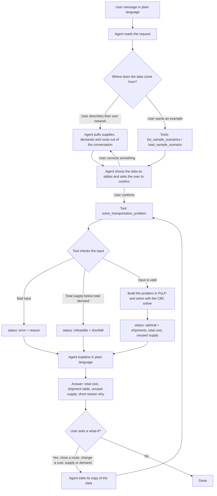

# agentic_logistic_handler

An agentic twist on the classical transportation problem.

You describe a shipping network in plain language: warehouses, stores, how much each one has or needs, and what each route costs. A chat agent built with Google's [Agent Development Kit (ADK)](https://adk.dev/get-started/python/) turns that description into a transportation problem and solves it exactly with [PuLP](https://coin-or.github.io/pulp/), a free linear-programming library. It then explains the result and re-plans when you ask "what if?"

> **Status:** in development. This README describes the design in [`PLAN.md`](PLAN.md). The setup and run steps below apply once the code in `logistics_agent/` is in place.

---

## The problem being solved

- **Sources** (warehouses) each have a **supply**: units on hand.
- **Destinations** (stores) each have a **demand**: units they need.
- Each route from a source to a destination has a **cost per unit**.
- The goal is to decide how many units to send on each route so that every store gets what it needs, no warehouse ships more than it has, and the total shipping cost is as low as possible.

A route that doesn't exist, such as a closed road or a lane with no carrier, is left out of the cost table, and the solver never uses it.

---

## How the agentic workflow runs, from input to output

There are two parts, and each does what it's good at:

| Part | What it does | What it never does |
|---|---|---|
| **The agent** (a Gemini model running inside ADK) | Talks with the user, gathers and organizes the data, decides when to call a tool, explains results, handles follow-up questions | Never works out the shipping plan or any of its numbers itself |
| **The tools** (plain Python functions) | Load sample data, check the input, build the problem, solve it with PuLP, return exact numbers | Never talk to the user |

So the language model handles the conversation and the solver handles the math. Every number in the final answer comes from the user or from a tool.

### Overview



### Step 1: The user describes the problem

The input is a normal chat message. It can be:

- **A description of their own network**, e.g. *"I have two factories, A with 100 units and B with 150. Store X needs 120 and store Y needs 130. A to X costs $4 a unit ..."*
- **A request for an example**, e.g. *"Show me the sample scenarios."*
- **A general question**, e.g. *"What can you do?"* The agent explains its job and offers the sample scenarios.

### Step 2: The agent gathers the data

The agent needs three things before it can solve anything:

1. **Supplies**: each warehouse and how many units it has.
2. **Demands**: each store and how many units it needs.
3. **Costs**: the per-unit cost of each route that exists.

**From the conversation:** the agent pulls these numbers out of what the user wrote. If something is missing (say, a route cost wasn't mentioned), it asks. It doesn't guess.

**From the sample data:** the agent calls two tools:

- `list_sample_scenarios()` returns the name and a one-line description of each built-in scenario.
- `load_sample_scenario(name)` returns that scenario's supplies, demands and costs. An unknown name returns an `error`.

Three samples are included:

| Scenario | What it shows |
|---|---|
| `us_retail_basic` | 3 warehouses, 4 stores, total supply = total demand = 1,200 units |
| `us_retail_surplus` | Same, but Denver has 700 units, so 200 are left over |
| `us_retail_shortage` | Same, but Atlanta has only 200 units, so there aren't enough to go around |

### Step 3: The agent confirms the data with the user

Before solving, the agent shows the data as a small table and asks the user to confirm it. This catches mistakes in how it read the message, such as a cost on the wrong route or a typo in a number. If the user corrects something, the agent updates the table and asks again. If the user said "just solve it", the agent skips this step.

For `us_retail_basic`, the table looks like this:

| Cost $/unit | Phoenix | Houston | Miami | Chicago | **Supply** |
|---|---|---|---|---|---|
| Dallas  | 8  | 3 | 9  | 7 | 300 |
| Atlanta | 12 | 6 | 4  | 6 | 400 |
| Denver  | 5  | 7 | 13 | 8 | 500 |
| **Demand** | 250 | 350 | 400 | 200 | |

### Step 4: The agent calls the solver tool

The agent passes the confirmed data to `solve_transportation_problem(supplies, demands, costs)` as structured data:

```python
supplies = {"Dallas": 300, "Atlanta": 400, "Denver": 500}
demands  = {"Phoenix": 250, "Houston": 350, "Miami": 400, "Chicago": 200}
costs    = {
    "Dallas":  {"Phoenix": 8,  "Houston": 3, "Miami": 9,  "Chicago": 7},
    "Atlanta": {"Phoenix": 12, "Houston": 6, "Miami": 4,  "Chicago": 6},
    "Denver":  {"Phoenix": 5,  "Houston": 7, "Miami": 13, "Chicago": 8},
}
```

ADK lets the model call this function directly. The model knows what the tool does from the function's name, argument types and docstring. The ADK Dev UI shows every tool call with its exact arguments and response, so you can check that the model passed the right data and didn't invent the answer.

### Step 5: The tool checks the input

Before solving, the tool rejects input that can't produce a sensible plan:

| Problem in the input | What the tool returns |
|---|---|
| No warehouses or no stores | `error` |
| A negative supply, demand or cost | `error` |
| A cost entry for a city that isn't listed as a warehouse or store | `error` naming the city |
| A store with no route into it | `error` naming the store |
| Numbers sent as text (e.g. `"300"`) | Converted to numbers, or `error` if they can't be |
| Total supply is less than total demand | `infeasible`, with both totals and the shortfall |

The shortage case is caught before solving because the answer is obvious: if there are 1,200 units of demand and only 1,000 units in stock, no plan can work.

### Step 6: The tool builds the problem and solves it

If the input passes, the tool builds the problem in PuLP:

- **One variable per route** that appears in the cost table: the number of units shipped on that route, never below zero. Missing routes get no variable, so they can't be used. Internally the variables get simple names like `x_0_2`, with a lookup back to the real city names, so names with spaces or punctuation (like "New York") work fine.
- **Goal:** keep the total cost as low as possible, where total cost = the sum over all routes of (cost per unit × units shipped).
- **Supply rule:** for each warehouse, total units shipped out ≤ its supply.
- **Demand rule:** for each store, total units shipped in ≥ its demand.

PuLP then runs the CBC solver, which comes bundled with PuLP. CBC returns the plan with the lowest possible cost, not just a good guess. Some problems have more than one plan with the same lowest cost. In that case CBC returns one of them.

### Step 7: The tool returns a structured result

For `us_retail_basic`, the result is:

```python
{
  "status": "optimal",
  "total_cost": 5700.0,
  "shipments": [
    {"from": "Dallas",  "to": "Houston", "units": 300.0, "unit_cost": 3.0, "route_cost": 900.0},
    {"from": "Atlanta", "to": "Miami",   "units": 400.0, "unit_cost": 4.0, "route_cost": 1600.0},
    {"from": "Denver",  "to": "Phoenix", "units": 250.0, "unit_cost": 5.0, "route_cost": 1250.0},
    {"from": "Denver",  "to": "Houston", "units": 50.0,  "unit_cost": 7.0, "route_cost": 350.0},
    {"from": "Denver",  "to": "Chicago", "units": 200.0, "unit_cost": 8.0, "route_cost": 1600.0},
  ],
  "unused_supply": {"Dallas": 0.0, "Atlanta": 0.0, "Denver": 0.0},
  "total_supply": 1200.0,
  "total_demand": 1200.0,
}
```

Only routes that carry goods are listed. If the solver ends in any state other than optimal, the tool returns that state with a plain-language message, never a made-up plan.

### Step 8: The agent explains the result

The agent turns the tool's output into a short answer:

- **Total cost**: $5,700.
- **Shipment table**: from, to, units and cost for each route used.
- **Unused supply**: units left at each warehouse, if any.
- **A sentence or two on why the plan looks this way**, e.g. *"Atlanta sends everything to Miami because at $4 a unit it's by far the cheapest way to supply Miami. Dallas covers Houston at $3 a unit, and Denver covers the rest."*

If the tool returned `infeasible`, the agent explains the shortfall and suggests fixes: add supply, reduce demand, or accept that some demand won't be met. If it returned `error`, the agent explains what's wrong with the data and asks the user to fix it.

### Step 9: What-if follow-ups

The agent remembers the current scenario for the rest of the conversation. When the user asks a what-if, it edits its copy of the data and calls the solver again with the full, updated data:

| User says | What the agent changes |
|---|---|
| "Atlanta to Miami is closed" | Removes that route from `costs` |
| "Dallas to Houston now costs $5" | Changes that route's cost |
| "Denver gets 100 more units" | Changes Denver's supply |
| "Chicago needs 50 fewer" | Changes Chicago's demand |

The agent then compares the new answer with the previous one: how the total cost changed and which routes changed.

**Example: Atlanta→Miami closed.** The solver returns a total of $8,700, which is $3,000 more:

| From | To | Before | After |
|---|---|---|---|
| Dallas | Houston | 300 | — |
| Dallas | Miami | — | 300 |
| Atlanta | Miami | 400 | — (closed) |
| Atlanta | Houston | — | 200 |
| Atlanta | Chicago | — | 200 |
| Denver | Phoenix | 250 | 250 |
| Denver | Houston | 50 | 150 |
| Denver | Miami | — | 100 |
| Denver | Chicago | 200 | — |

Miami loses its $4 route and now has to be supplied from Dallas ($9) and Denver ($13). That pulls Dallas away from Houston, and the other routes rearrange to cover the gap.

**Example: Atlanta has only 200 units** (with the route reopened). Total supply drops to 1,000 against 1,200 of demand. The tool returns `infeasible`, 200 units short, and the agent suggests ways to close the gap.

---

## Project layout

```
logistic_handler/
├── README.md
├── PLAN.md                 # full build plan
├── requirements.txt
├── logistics_agent/        # the ADK agent package
│   ├── __init__.py
│   ├── agent.py            # defines root_agent: model, instructions, tools
│   ├── tools.py            # sample-data tools and the PuLP solver
│   ├── scenarios.py        # sample scenarios
│   └── .env.example        # template for your API key
└── tests/
    └── test_tools.py
```

## Setup

1. **Python 3.11+**: check with `python3 --version`.
2. **Create a virtual environment and install dependencies:**
   ```bash
   python3 -m venv .venv
   source .venv/bin/activate
   pip install -r requirements.txt
   ```
3. **Get a Gemini API key** (free tier, no billing needed): go to https://aistudio.google.com/apikey, sign in with a personal Google account, click **Create API key**, and copy it.
4. **Add the key:**
   ```bash
   cp logistics_agent/.env.example logistics_agent/.env
   ```
   Then paste your key into `logistics_agent/.env`. This file is git-ignored. Never commit it.

Free-tier keys have per-minute and per-day request limits. If you see `429 RESOURCE_EXHAUSTED`, wait a minute or enable billing on the key's project.

## Run

From the repo root (the folder that contains `logistics_agent/`):

```bash
source .venv/bin/activate
adk web                    # Dev UI at http://localhost:8000; pick "logistics_agent"
# or
adk run logistics_agent    # chat in the terminal
```

### Try this

1. "Hi, what can you do?"
2. "Show me the sample scenarios." Then: "Load the basic US retail one and solve it." Expect $5,700.
3. "The Atlanta to Miami route is closed this week. Re-plan." Expect $8,700 and an explanation of the extra $3,000.
4. "What if Atlanta only has 200 units?" (route reopened) Expect: not enough supply, 200 units short.
5. Describe your own small network in words and let the agent build the tables, confirm them and solve.

## Tests

```bash
pytest -q
```

The tests call the solver directly, without the model, and check the sample results above, the surplus and shortage cases, bad input, and city names with spaces.

## License

See [LICENSE](LICENSE).
