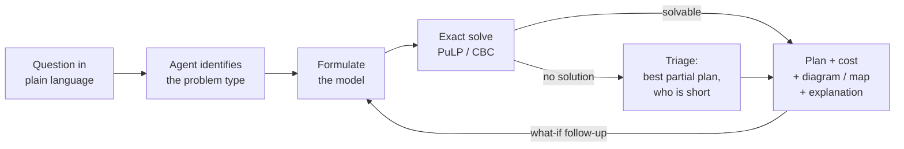
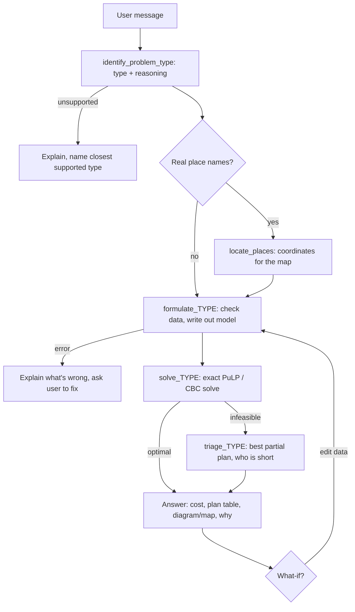

# Agentic Logistic Handler

An agent that solves logistics optimization problems described in plain language.

You describe what needs to move where: warehouses and stores, plants and distribution centers, product lines sharing trucks, or a fleet of delivery vans. A chat agent built with Google's [Agent Development Kit (ADK)](https://adk.dev/get-started/python/) works out **which kind of optimization problem it is**, writes it out as a model, and solves it exactly with [PuLP](https://coin-or.github.io/pulp/), a free linear-programming library, and its bundled CBC solver. It then explains the plan, draws it as a network diagram or on a map, and re-plans when you ask "what if?"

When the problem has no solution as stated (not enough stock, a lane that can't carry enough, too few vehicles), the agent says why and runs a **triage** step: it finds the best partial plan and tells you exactly who is left short and by how much.

### Problem types

| Type | Use it when | Example sample |
|---|---|---|
| **Transportation** | One product goes straight from sources to destinations at a cost per unit | 3 warehouses supply 4 stores |
| **Minimum-cost flow** (transshipment) | One product passes through hubs (distribution centers, cross-docks) and/or lanes have capacity limits | 2 plants → 2 DCs → 3 cities |
| **Multi-product flow** | Several products share the same lanes; a lane's capacity limits all of them together; some lanes carry only some products | Frozen and dry goods on shared trucks |
| **Vehicle routing** | Vehicles leave one depot, visit customers in order and come back, within a load limit (up to 15 customers) | 3 vans, 8 customers |

### How it works



The Gemini agent handles the conversation, picks the problem type and decides which tool to call; Python tools do all the math. Every number in an answer comes from the user or a tool.

## Quick start

Needs Python 3.10+, internet access and a free Gemini API key.

```bash
git clone https://github.com/ibipul/agentic_logistic_handler.git
cd agentic_logistic_handler
```

> [!IMPORTANT]
> **Add your Gemini API key before the first run.** The repo doesn't include one.
>
> 1. Get a free key at https://aistudio.google.com/apikey (no billing needed).
> 2. Copy the template: `cp logistics_agent/.env.example logistics_agent/.env`
> 3. Open `logistics_agent/.env` and replace `PASTE_YOUR_AI_STUDIO_KEY_HERE` with your key:
>    ```
>    GOOGLE_GENAI_USE_VERTEXAI=FALSE
>    GOOGLE_API_KEY=AIza...your-key...
>    ```
>
> `logistics_agent/.env` is listed in `.gitignore`, so git won't commit your key. Don't put the key in `.env.example` or anywhere else that's tracked.

Then start the app:

```bash
./run.sh
```

`run.sh` walks through five numbered steps and says what it's doing at each one: check Python, install packages (first run only, usually 2-5 minutes, with pip's progress shown), check the API key, find a free port, start the server. When it prints **● Ready: http://localhost:8080** (or another port, see below), it opens the page in your browser. Keep that terminal open; press Ctrl+C there to stop.

**If something goes wrong, `run.sh` says so in the terminal:**

| You see | What it means / what to do |
|---|---|
| `Port 8080 is busy (used by …); trying 8081` | Another program has 8080. The app starts on the next free port; use the URL on the **Ready** line. |
| `An earlier run of this app is already serving http://localhost:…` | You started it before and it's still running. Use that URL, or stop it (Ctrl+C in its terminal, or the `kill` command shown) and run `./run.sh` again. |
| `Package install failed` | Usually a network problem. Run `./run.sh` again; if it keeps failing, delete the `.venv` folder and retry. |
| `Google rejected the key` / `Could not reach Google` | The page still opens, but the agent can't answer. Check the internet connection; the message shows Google's reason. |
| `Python 3.10 or newer is required` | Install a newer Python, or point to one: `PYTHON=/path/to/python3.11 ./run.sh`. |

To choose the port yourself: `PORT=9000 ./run.sh`. If that port is taken, `run.sh` stops and says what is using it.

### Try this

The **Sample problems** pane on the right lists two or three problems per type. Clicking one puts its text in the question box; press **Run agent**. The sample text never names the problem type, so you can watch the agent work it out: the first step in **Agent steps** is *Identify problem type*, with the agent's reasoning above it.

| Sample | What to expect |
|---|---|
| Transportation → **Warehouses → stores** | Minimum cost **$5,700**. Follow up with *"The Atlanta → Miami route is closed. Re-plan."*: **$8,700**, and the agent explains the extra $3,000. |
| Transportation → **Shortage → triage** | No solution (200 units short). Triage delivers all 1,000 units for **$4,900**; Miami gets 200 of its 400. |
| Min-cost flow → **Plants → DCs → stores** | **$2,800**. Both plant lanes run at capacity; 350 units go through Sacramento DC and 400 through Bakersfield DC; 50 units stay at each plant. |
| Min-cost flow → **Lane bottleneck → triage** | There's enough stock, but the storm-limited lane can't carry it. Triage: San Diego gets 50 of 150; cost **$2,000**. |
| Multi-product flow → **Frozen + dry, shared trucks** | **$4,600** ($2,400 frozen, $2,200 dry); Omaha → Chicago is full; no frozen goes on the dry-only lane. |
| Multi-product flow → **Capacity squeeze → triage** | Indianapolis' lane is cut to 150. Triage delivers 750 of 850 units for **$3,800**: Indianapolis gets its dry goods but none of its 100 frozen. Follow up with *"What if the Indianapolis lane goes back up to 250?"* to get back to $4,600. |
| Vehicle routing → **Delivery vans** | All 8 customers with 3 vans: **90 km, $180**, proven optimal. |
| Vehicle routing → **Van out of service → triage** | 220 crates, 2 vans of 100: no solution. Triage serves 7 of 8 customers (200 crates), leaves out Pharmacy, **$178.36**. |

Each result has a **Diagram / Map** toggle (see [Seeing the plan](#seeing-the-plan-diagram-and-map)). Expand **Arguments** / **Response** under any tool call to see exactly what the agent sent to the solver and what came back. Each solve step shows the exact open-source PuLP → CBC call, problem size and solve time.

You can also type your own problem, e.g. *"Factory A has 100 units, B has 150. Store X needs 120, Y needs 130. A→X $4, A→Y $6, B→X $5, B→Y $3."*

One question takes about 4-7 model calls (identify, locate places, formulate, solve, maybe triage, explain). On the free Gemini tier that can hit the per-minute limit; the agent waits and retries automatically, and the page says so.

---

## The problem types in detail

All four are solved exactly by PuLP + CBC. Each type has three tools: **formulate** (check the data and write out the model, no solving), **solve**, and **triage**.

### Transportation

- **Data:** supply at each source, demand at each destination, cost per unit on each open route.
- **Model:** one variable per open route (units shipped, ≥ 0). Minimize total cost, subject to: each source ships at most its supply; each destination gets at least its demand.
- **No solution when:** total supply is below total demand. That's caught from the totals, before calling the solver.
- **Triage:** every undelivered unit carries a penalty larger than any possible rerouting saving, so the solver first delivers every unit it can, then picks the cheapest way to do it.

### Minimum-cost flow (transshipment)

- **Data:** supplies, demands, and a list of lanes: `{"from", "to", "cost", "capacity"?}`. Places that appear only in lanes are **hubs**: what flows in must flow out.
- **Model:** one variable per lane, between 0 and the lane's capacity. Flow balance at every place: out − in ≤ supply − demand; at hubs out − in = 0.
- **Covers the transportation problem** (the tests check it gives the same $5,700), plus hubs and lane limits.
- **No solution when:** there isn't enough supply (reason `shortage`), or there is, but the lanes can't carry it (reason `network`: a capacity limit or a missing link). The second case is the interesting one: the totals look fine, so the agent needs the solver to find out.
- **Triage:** same penalty idea. It reports which destinations are short and which lanes are full (the bottlenecks that caused it).
- **Results include:** units through each hub, and which lanes are at capacity.

### Multi-product flow

- **Data:** supplies and demands per product (`supplies[product][place]`), and lanes with a per-unit `cost`, optional per-product `product_costs`, an optional shared `capacity`, and an optional list of `products` the lane may carry.
- **Model:** one variable per product per lane it may carry. Flow balance per product at every place; on each lane, the sum over all products ≤ capacity.
- **No solution when:** some product is short overall, or the shared lanes can't carry everything.
- **Triage:** reports which destination/product pairs are short. It cuts whatever is most expensive to deliver, which may not match business priorities; the agent says so.

### Vehicle routing (capacitated)

- **Data:** depot, demand per customer (up to 15), number of vehicles, vehicle capacity, and either coordinates (x, y in km, or latitude/longitude) or a distance table. Optional cost per km and fixed cost per vehicle used.
- **Model** (mixed-integer): a yes/no variable for each pair of places (does a vehicle drive straight from i to j?). Each customer is entered and left exactly once; at most K vehicles leave the depot and all come back. A load variable per customer enforces the capacity and rules out loops that skip the depot.
- **Exact but slow to grow:** fine for a demo-sized fleet. CBC gets a 30-second limit; if it stops early the result says the plan is the best found, not proven optimal.
- **No solution when:** total demand exceeds the fleet's capacity, an order is bigger than a vehicle, or the orders can't be packed into the vehicles.
- **Triage:** each customer becomes optional, with a penalty per undelivered unit. The solver serves as much demand as possible, then minimizes driving. Orders bigger than a vehicle are reported separately.

---

## Seeing the plan: diagram and map

Every formulate, solve and triage result includes a small network description (places with roles, lanes with units and capacity, or vehicle routes). The page draws it two ways, using free open-source libraries loaded from a CDN:

- **Diagram** ([Cytoscape.js](https://js.cytoscape.org/), MIT license): sources on the left, hubs in the middle (diamonds), destinations on the right. Line width = units shipped, orange = lane at full capacity, dashed = unused lane. Vehicle routes are drawn at their coordinates, one color per vehicle; customers left out by triage are red.
- **Map** ([Leaflet](https://leafletjs.com/), BSD license, with [OpenStreetMap](https://www.openstreetmap.org/copyright) tiles): the same network over a real map.

The map needs coordinates. When a problem names real places, the agent calls `locate_places`, which looks the names up with OpenStreetMap's free [Nominatim](https://nominatim.org/) service (no key; at most one request per second, as its usage policy asks; results cached). The agent maps each name used in the data to a search text, e.g. `"Sacramento DC" → "Sacramento, California"`. If the lookup fails, the page shows the diagram only. The coordinates are only for drawing, except in vehicle routing with real places and no distances given, where the agent may use them for straight-line distances and says so. They're never used to make up shipping costs.

Map lines are straight segments between places, not road routes.

---

## How the agentic workflow runs

| Part | What it does | What it never does |
|---|---|---|
| **The agent** (a Gemini model running inside ADK) | Talks with the user, identifies the problem type, gathers the data, decides which tool to call, explains results, handles follow-ups | Never works out a plan, a route or any of their numbers itself |
| **The tools** (plain Python functions) | Return the data checklist for a type, look up coordinates, check the input, build the model, solve it with PuLP, return exact numbers | Never talk to the user |



1. **Identify.** The agent calls `identify_problem_type(problem_type, reasoning)`. The tool returns that type's data checklist, the names of its formulate / solve / triage tools, and what the answer should cover. This keeps the agent's main instructions short: per-type details arrive only when needed. The page shows the type as a badge with the agent's reasoning.
2. **Get the data.** From the message, or from a sample (`list_sample_problems` / `load_sample_problem`). If something is missing or contradictory, the agent asks. It never invents costs, capacities or demands.
3. **Locate** (only for real place names): `locate_places`, for the map.
4. **Formulate.** It checks the data and writes out the model: tables of places and lanes (or customers and distances), the objective, the constraints, and the variables. The page shows this in **Problem type & formulation**.
5. **Solve.** It's exact: `optimal` with the plan, or `infeasible` with the reason.
6. **Triage** if infeasible: the best partial plan, and who is short.
7. **Explain.** Total cost, the key table for the type, bottlenecks or unused supply, and one or two sentences on why the plan looks this way.
8. **What-ifs.** The agent edits its copy of the data (close a lane, change a cost, capacity, supply, demand, vehicle count) and re-runs formulate → solve, comparing with the previous answer. It doesn't re-identify the type unless the change makes it a different kind of problem.

### Input checks

Every tool rejects input that can't produce a sensible plan and says why: missing sources or destinations, negative numbers, a lane or route to a place that isn't listed, the same lane listed twice, a destination with no incoming lane, numbers that aren't numbers (numeric strings like `"300"` are accepted), more than 15 customers for vehicle routing, and so on.

---

## Worked example: transportation

For the **Warehouses → stores** sample, the formulation table is:

| Cost $/unit | Phoenix | Houston | Miami | Chicago | **Supply** |
|---|---|---|---|---|---|
| Dallas  | 8  | 3 | 9  | 7 | 300 |
| Atlanta | 12 | 6 | 4  | 6 | 400 |
| Denver  | 5  | 7 | 13 | 8 | 500 |
| **Demand** | 250 | 350 | 400 | 200 | |

The agent calls `solve_transportation_problem(supplies, demands, costs)` with:

```python
supplies = {"Dallas": 300, "Atlanta": 400, "Denver": 500}
demands  = {"Phoenix": 250, "Houston": 350, "Miami": 400, "Chicago": 200}
costs    = {
    "Dallas":  {"Phoenix": 8,  "Houston": 3, "Miami": 9,  "Chicago": 7},
    "Atlanta": {"Phoenix": 12, "Houston": 6, "Miami": 4,  "Chicago": 6},
    "Denver":  {"Phoenix": 5,  "Houston": 7, "Miami": 13, "Chicago": 8},
}
```

and gets back (abridged; every result also carries a `display` block for the page and a `solver` block describing the PuLP call):

```python
{
  "status": "optimal",
  "total_cost": 5700.0,
  "shipments": [
    {"from": "Dallas",  "to": "Houston", "units": 300.0, "unit_cost": 3.0, "cost": 900.0},
    {"from": "Atlanta", "to": "Miami",   "units": 400.0, "unit_cost": 4.0, "cost": 1600.0},
    {"from": "Denver",  "to": "Phoenix", "units": 250.0, "unit_cost": 5.0, "cost": 1250.0},
    {"from": "Denver",  "to": "Houston", "units": 50.0,  "unit_cost": 7.0, "cost": 350.0},
    {"from": "Denver",  "to": "Chicago", "units": 200.0, "unit_cost": 8.0, "cost": 1600.0},
  ],
  "unused_supply": {"Dallas": 0.0, "Atlanta": 0.0, "Denver": 0.0},
}
```

**What-if: Atlanta → Miami closed.** The agent removes that route and re-solves: $8,700, or $3,000 more. Miami loses its $4 route and has to be supplied from Dallas ($9) and Denver ($13), which pulls Dallas away from Houston. This case has more than one plan costing exactly $8,700, so the solver may return a different set of routes each time; the total is always $8,700.

**Shortage: Atlanta has only 200 units.** Total supply is 1,000 against 1,200 of demand, so `solve_transportation_problem` returns `infeasible` (200 short) without calling the solver. `triage_transportation_problem` then delivers all 1,000 units for $4,900: Phoenix, Houston and Chicago are fully served, and Miami gets 200 of its 400.

---

## Project layout

```
logistic_handler/
├── README.md
├── PLAN.md                     # original build plan (transportation only)
├── requirements.txt
├── run.sh                      # one-command launcher for the web UI
├── logistics_agent/            # the ADK agent package
│   ├── agent.py                # root_agent: model, instructions, tools
│   ├── tools.py                # identify_problem_type, sample tools, the full tool list
│   ├── places.py               # locate_places: OpenStreetMap Nominatim lookup for the map
│   ├── samples.py              # sample problems (data + plain-language question)
│   ├── problems/
│   │   ├── __init__.py         # PROBLEM_TYPES registry: when to use, data, tools per type
│   │   ├── common.py           # input checks, the PuLP/CBC call, display blocks
│   │   ├── transportation.py
│   │   ├── network_flow.py     # minimum-cost flow and multi-product flow (one engine)
│   │   └── vehicle_routing.py
│   ├── .env                    # your Gemini API key (you create it; ignored by git)
│   └── .env.example            # template: copy to .env and add your key
├── web/
│   ├── server.py               # FastAPI app: runs the agent, streams its steps, serves samples
│   └── index.html              # the page: question, sample pane, formulation, steps, result, diagram/map
└── tests/
    ├── test_transportation.py
    ├── test_network_flow.py
    ├── test_vehicle_routing.py # includes a brute-force check that routes are truly optimal
    └── test_agent_tools.py     # registry, samples, ADK tool declarations, place lookup
```

**Adding a problem type:** write `formulate_*`, `solve_*` and `triage_*` functions in `problems/` that return the same `status` / `stage` / `summary` / `display` fields, add an entry to `PROBLEM_TYPES` and the functions to `SOLVER_TOOLS`, and add a sample or two to `samples.py`. The agent instructions, the page and the sample pane pick it up from the registry.

## Setup

`./run.sh` does all of this for you. To do it by hand:

1. **Python 3.10+**: check with `python3 --version`.
2. **Create a virtual environment and install dependencies:**
   ```bash
   python3 -m venv .venv
   source .venv/bin/activate
   pip install -r requirements.txt
   ```
3. **API key:** copy `logistics_agent/.env.example` to `logistics_agent/.env` and set `GOOGLE_API_KEY` to your key (see the box under [Quick start](#quick-start)). `run.sh` stops with a message if this file is missing.

Free-tier keys have per-minute and per-day request limits. If you see `429 RESOURCE_EXHAUSTED`, wait a minute and try again.

The model is set in `logistics_agent/agent.py` (`gemini-3.8-flash`). To try another one without editing code, set `LOGISTICS_MODEL`, e.g. `LOGISTICS_MODEL=gemini-flash-latest ./run.sh`.

## Run

**Web UI** (recommended):

```bash
./run.sh                   # http://localhost:8080 ; use PORT=9000 ./run.sh to change the port
```

**ADK's own tools**, from the repo root with the venv active:

```bash
adk web                    # ADK Dev UI at http://localhost:8000; pick "logistics_agent"
adk run logistics_agent    # chat in the terminal
```

## Tests

```bash
pytest -q
```

The tests call the tools directly, without the model. They check:

- every sample's result;
- that minimum-cost flow reproduces the transportation answer;
- hub balance, lane capacities and product restrictions;
- each kind of infeasibility and its triage;
- that vehicle routes match a brute-force search on a small case;
- bad input;
- that ADK can build a declaration for every tool.

## License

See [LICENSE](LICENSE).
